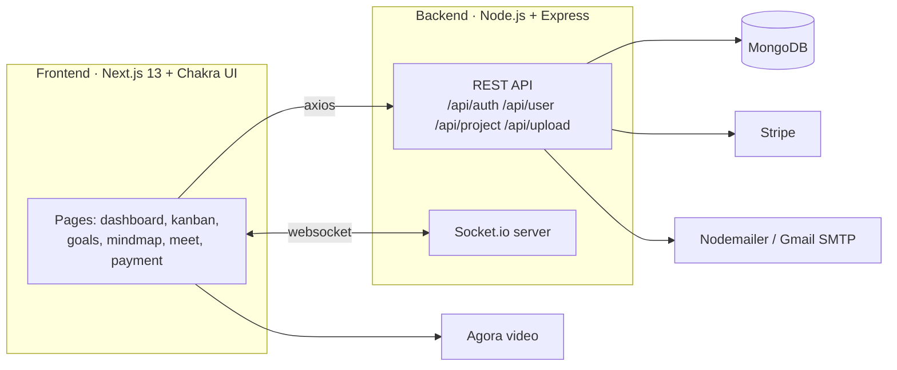

# AtmoWork: All-in-One Project Management Platform


> 🎓 **Final Year Project:** a collaboration workspace that brings tasks, teammates, meetings and planning tools together in one place.

AtmoWork replaces the scattered tools a team usually juggles. It includes Kanban boards, goals, mind maps, real-time chat, video meetings, invitations and subscription payments, all in one web app.

## ✨ Features

| Module | What it does |
|--------|--------------|
| 🔐 **Authentication** | Register / sign in with JWT (httpOnly cookies) and bcrypt-hashed passwords |
| 🗂️ **Spaces & projects** | Create projects and invite members by email |
| 📋 **Kanban boards** | Drag-and-drop task boards per project |
| 🎯 **Goals** | Define goals with sub-tasks and track progress |
| 🧠 **Mind maps** | Collaborative whiteboard / mind mapping (Excalidraw) |
| 💬 **Discussion** | Real-time project chat with Socket.io |
| 🎥 **Meetings** | In-browser video calls (Agora) |
| 🔔 **Notifications** | Activity notifications for invites and updates |
| 💳 **Payments** | Membership plans with Stripe checkout and email receipts |
| 🌍 **i18n & theming** | Multi-language UI (i18next) and light/dark mode |

## 🏗️ Architecture



## 🧰 Tech stack

**Frontend:** Next.js 13, React 18, TypeScript, Chakra UI, Framer Motion, dnd-kit / react-kanban, Excalidraw, Agora UIKit, i18next

**Backend:** Node.js, Express, Mongoose (MongoDB), Socket.io, JWT, bcrypt, Multer (uploads), Stripe, Nodemailer

## 📁 Project structure

```
atmowork-main/
├── frontend/
│   ├── pages/            # dashboard/{home,spaces,kanban,goals,mindmap,meet,...}, signin, register
│   ├── src/components/   # layout, dashboard widgets, kanban cards, video call
│   ├── internationalization/
│   └── package.json
└── backend/
    ├── controllers/      # Auth, User, Project, Goal, Chat, MindMap, Meet, Invite, Upload
    ├── models/           # User, Project, Members, Goals, GoalTask, Chat, MindMap, Meet, ...
    ├── routes/           # AuthRoute, UserRoutes, ChatRoutes
    ├── middleware/       # JWT auth middleware
    └── index.js          # Express + Socket.io server
```

## 🚀 Getting started

### Backend

```bash
cd atmowork-main/backend
npm install
```

MongoDB is expected at `mongodb://127.0.0.1:27017/atmowork`. Create `backend/.env`:

```env
PORT=5000
JWT_SECRET=change-me
APP_URL=http://localhost:3000
BACKEND_URL=http://localhost:5000
STRIPE_BK=sk_test_...          # Stripe secret key
SMTP_GMAIL_USER=you@gmail.com  # for invitation / receipt emails
SMTP_GMAIL_PASS=app-password
```

```bash
node index.js
```

### Frontend

```bash
cd atmowork-main/frontend
npm install
```

Create `frontend/.env.local`:

```env
NEXT_PUBLIC_backendURL=http://localhost:5000
NEXT_PUBLIC_AGORA_CLIENT=your-agora-app-id
NEXT_PUBLIC_stripe_public_key=pk_test_...
```

```bash
npm run dev        # http://localhost:3000
```

## 🗺️ Roadmap

- [ ] Assign tasks to specific members
- [ ] Project admins can remove members
- [ ] Goal detail view

## 👥 Team

Built as a university Final Year Project.
